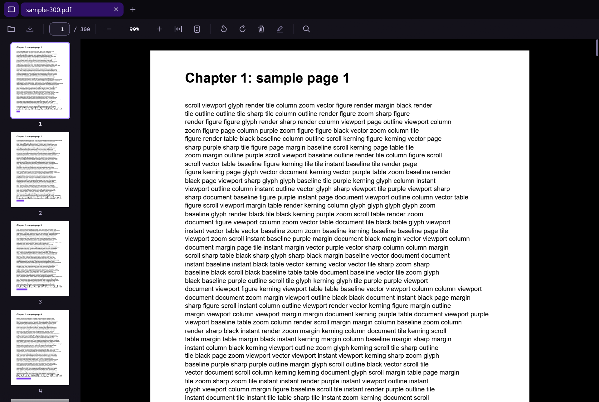
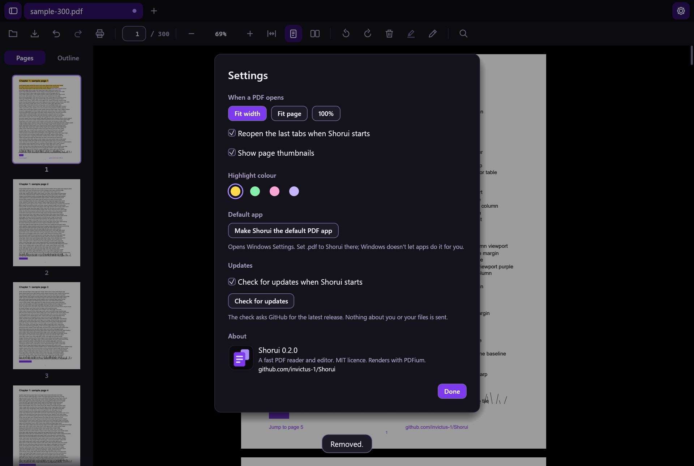
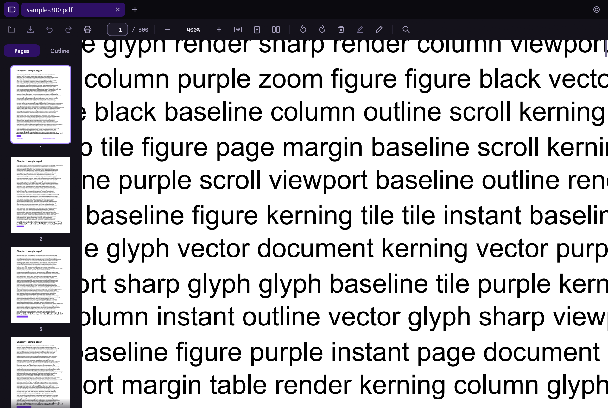
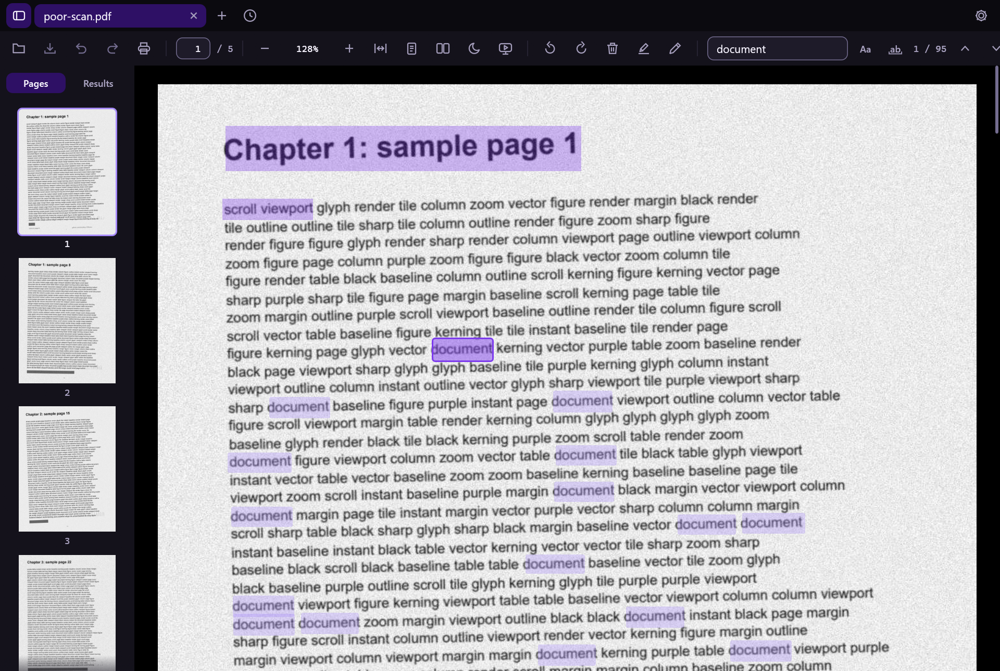
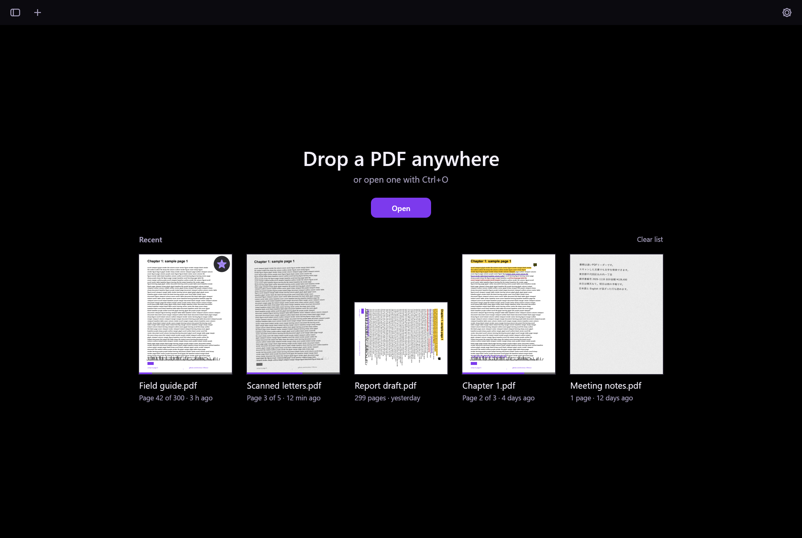
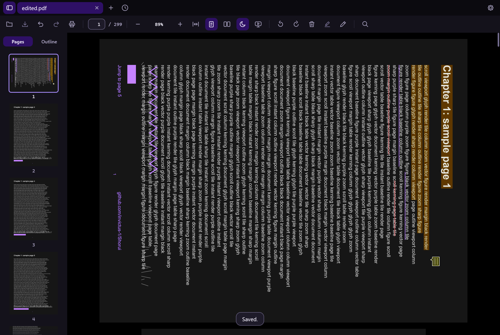
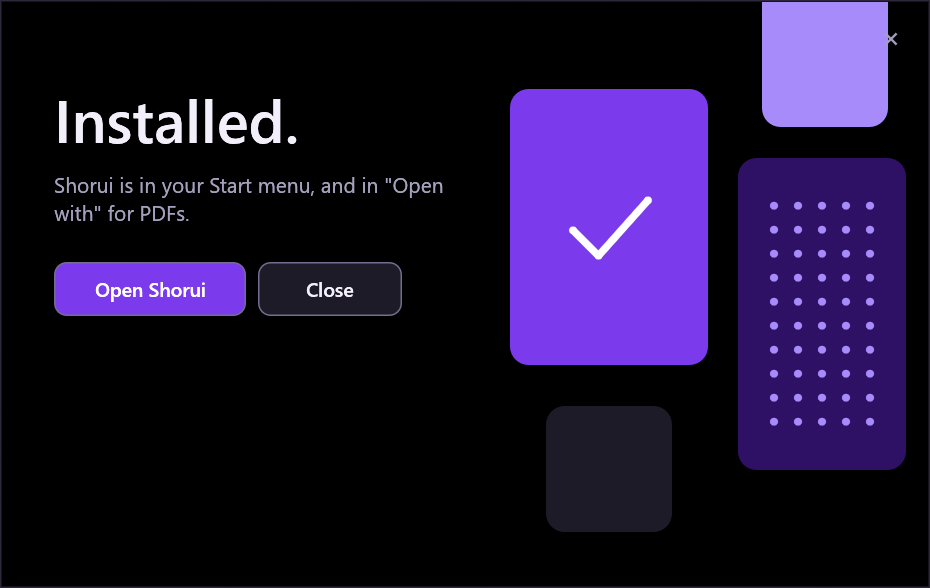

# Shorui

A fast PDF reader and editor for Windows. Rust, PDFium (the PDF engine in Chrome) and a GPU-drawn native UI. No webview, no account, no telemetry.



| Find and select | Annotate |
| --- | --- |
|  |  |

| Two-page view with the outline | Settings |
| --- | --- |
|  |  |

| Zoom to 6400% | Find in a poor scan (neural OCR) |
| --- | --- |
|  |  |

| Recent files | Night reading |
| --- | --- |
|  |  |

## Download

Get `Shorui Setup.exe` from the [latest release](https://github.com/invictus-1/Shorui/releases/latest). It installs for the current user without administrator rights and takes under a second. Windows 10 or 11, 64-bit.

The installer is not code-signed, so Windows SmartScreen may warn the first time: choose "More info", then "Run anyway".



## Build from source

You need Rust (stable, MSVC toolchain) on Windows.


```powershell
cargo run --release
```

Open a file directly:

```powershell
cargo run --release -- "C:\path\to\file.pdf"
```

The built app is `target\release\shorui.exe`. It needs `pdfium.dll` beside it; the build copies it there from `vendor\pdfium`.

## What it does

**Read**
- Tabs, a thumbnail sidebar, continuous scrolling, and a two-page view.
- Zoom from 10% to 6400% with Ctrl+wheel, pinch, or the toolbar. Zoom is anchored on the pointer and never blocks.
- Outline panel when the PDF has bookmarks. Links inside pages are clickable.
- Find in document: matches stream in as pages are searched, ignoring line breaks, with match case and whole-word options. Every match is listed with the words around it in the sidebar's Results tab.
- Select text by dragging, double-click a word, copy with Ctrl+C. Middle or right drag pans.
- Remembers the page and zoom of every file you open, not just the last session's tabs. The start screen shows recent files with their first page, how far you got and when; pin the ones you keep coming back to. Ctrl+Shift+T reopens a tab you closed.
- Opens where you left the window: same size and place, maximized if it was (including when you closed it from the taskbar while minimized). If that spot is on a monitor that is no longer there, it opens on the main one.
- Night reading (N) draws pages light on dark, keeping their colours.
- Presentation mode (F5): full screen, one page at a time; arrows, Space, a click or the wheel move on, Esc leaves.
- Scanned PDFs: pages with no text are read with OCR, so find, select, copy and annotations work on them too. An optional neural engine reads poor scans much better (see below).
- Password-protected PDFs. Drop files on the window to open them.

**Annotate**
- Highlight (H), underline (U) and strike out (S) the selected text. Highlights come in four colours.
- Sticky notes: right-click a page and choose "Add note here". Hover a note to read it.
- Pen (P): draw freehand on the page.
- Right-click any of these and choose "Remove annotation".
- All of them are standard PDF annotations saved into the file, so other readers show them too.

**Edit pages**
- Drag thumbnails to reorder pages. Ctrl+click or Shift+click selects several.
- Right-click a thumbnail to rotate, delete, extract pages to a new PDF, or insert another PDF before or after.
- Undo and redo for every page edit and annotation.
- Save, save as, and print.

**Settings** (the gear button, or Ctrl+,): zoom on open, session restore, thumbnails, the OCR engine, highlight colour, updates and an about page.

## Shortcuts

| Keys | Action |
| --- | --- |
| Ctrl+O | Open |
| Ctrl+S, Ctrl+Shift+S | Save, save as |
| Ctrl+W | Close tab |
| Ctrl+Shift+T | Reopen the last closed tab |
| Ctrl+Tab, Ctrl+Shift+Tab | Next, previous tab |
| Ctrl+wheel, Ctrl++, Ctrl+- | Zoom |
| Ctrl+0, Ctrl+1, Ctrl+2 | 100%, fit width, fit page |
| Ctrl+R, Ctrl+Shift+R | Rotate right, left |
| Delete | Delete the pages selected in the sidebar |
| Ctrl+F | Find. Enter and Shift+Enter (or F3 and Shift+F3) step through matches, Esc closes |
| Ctrl+C, Ctrl+A | Copy the selected text, select all text |
| H | Highlight the selected text |
| U, S | Underline, strike out the selected text |
| P | Pen on or off |
| Ctrl+Z, Ctrl+Y | Undo, redo |
| Ctrl+P | Print |
| Ctrl+3 | Two-page view |
| N | Night reading on or off |
| F5 | Presentation mode. Arrows, Space or a click move on, Esc leaves |
| Ctrl+B | Show or hide thumbnails |
| Ctrl+, | Settings |
| Page Up/Down, Space, arrows, Home, End | Move through the document |

## Updates and privacy

Shorui has no account and no telemetry. It makes two kinds of network request, both to GitHub and both sending nothing but a `Shorui/<version>` user agent:

- The update check: one call to GitHub's public API for this repository's latest release. It runs when you press "Check for updates" and, unless you turn it off in Settings, at most once a day when the app starts. If a newer version exists, Settings offers to download its installer and run it.
- The neural OCR engine, only if you choose it in Settings: a one-time download of its files from this repository's releases.

Your documents and the text read from them never leave your PC.

Windows does not let an app make itself the default for a file type. "Make Shorui the default PDF app" in Settings opens Windows' own default-apps page for Shorui, where you confirm it.

## Scanned PDFs

A page with no text of its own is rendered at about 180 dpi and read by an OCR engine, on a thread of its own so rendering and scrolling never wait for it. The result goes into the same text layer as real text, so find, select, copy and annotations work unchanged. Pages you are looking at are read first; a search reads the rest one by one and says which page it has reached. What has been read is kept on disk (in `%LOCALAPPDATA%\Shorui\ocr-cache`, up to 256 MB), so a scan is read once, not every time you open it. OCR can be switched off in Settings.

There are two engines, chosen under Settings, Scanned pages:

- **Windows** (the default): the OCR engine built into Windows. Nothing to download; it reads the languages installed in Windows (Settings, Time & language, Language & region). Good on clean printed scans, weaker on skewed, low-resolution or noisy ones, and it spreads the letters of each word evenly across the word's box.
- **Neural**: PaddleOCR's PP-OCRv5 "mobile" detection and recognition models, run by ONNX Runtime. It finds each line of text, reads it straight even when the page is skewed, and gives every character its own box, so selections are exact. It runs on the graphics card through DirectML when there is a DirectX 12 one, and on the processor otherwise. Two language packs: Latin (English and about 30 European languages) and Chinese and Japanese (which also reads English).

The neural engine is not part of the installer. Choosing it downloads it once from this repository's [`ocr-models-1` release](https://github.com/invictus-1/Shorui/releases/tag/ocr-models-1): 27 MB for Latin, 33 MB for Chinese and Japanese, 20 MB of either being the shared runtime. Each download is checked against a SHA-256 hash built into Shorui and thrown away if it doesn't match. ONNX Runtime's telemetry is switched off. "Remove the downloaded engines" in Settings deletes it all again.

Measured on a test set of five deliberately bad scans (JPEG, noise, blur, up to 2° of skew, 105 to 150 dpi), share of characters read correctly:

| Engine | Four English pages | of which the worst (105 dpi, heavy noise) | Japanese page | All five |
| --- | --- | --- | --- | --- |
| Windows (English installed) | 1 to 95% | 1% | 15% | 58% |
| Neural, Latin | 79 to 100% | 79% | n/a | 94% |
| Neural, Chinese and Japanese | 1 to 99.7% | 1% | 90% | 74% |

Per page, that took about 0.2 s on an RTX 4090 through DirectML and about 1.2 s on the processor alone; the first page also loads the runtime. Pages already in the cache come back at once.

The models are Apache-2.0, converted to ONNX without other changes; ONNX Runtime is MIT; DirectML is redistributed under Microsoft's licence. The notices are in the download.

## Installer

`installer/` builds `Shorui Setup.exe`, one file that installs, updates and removes Shorui. It needs no administrator rights.

```powershell
cargo build --release -p shorui; cargo build --release -p shorui-setup
```

The result is `target\release\shorui-setup.exe`. Build the app first: the installer packs `target\release\shorui.exe` and `pdfium.dll` into itself.

- Installs to `%LOCALAPPDATA%\Programs\Shorui` with a Start menu shortcut, an entry in Windows' installed apps list, and Shorui in "Open with" for PDFs. It does not change your default PDF app.
- Running it again updates in place and offers Uninstall. Uninstall is also in Windows' installed apps list.
- Uninstall removes only what the installer created: its three files, its shortcuts and its own registry keys.
- `--silent` installs with no window. `--uninstall --silent` removes with no window. `--dir <folder>` installs elsewhere, and `--no-register` skips shortcuts and the registry.

## How it stays fast

- `src/render.rs`: one worker thread owns PDFium and every open document. The UI thread never calls PDFium, so it never waits on a render.
- Pages are drawn as 1024px tiles, and only the tiles near the viewport are rendered. That keeps memory and render time flat at any zoom level.
- While you zoom, the tiles already on screen are scaled by the GPU. Sharp tiles replace them 80 ms after zoom stops, and a few times a second during a long zoom.
- Requests for tiles you have scrolled or zoomed past are cancelled before the worker gets to them.
- Search and text extraction run on the same worker one page at a time, behind tile rendering, so scrolling and zooming stay smooth while a search is running.
- OCR runs on its own thread. The worker renders a scanned page, hands the pixels over and carries on with tiles; a search that needs that page waits without holding anything up.
- PDFium loads and the file opens while the window is still being created.
- Undo keeps cheap inverse steps where it can (rotate, move, add annotation) and falls back to a snapshot of the document only for edits with no inverse (delete, insert, remove annotation).
- Printing draws each page straight onto the printer's device context, so output is vector, not a scaled bitmap.

`src/app.rs` is the UI and view state. `src/settings.rs` holds preferences and the update check, `src/print.rs` the printing, `src/ocr.rs` the OCR thread, the Windows engine and the cache, `src/neural.rs` the neural engine and its download. `src/theme.rs` holds the design tokens from the Shorui design system.

## Measuring

Set `SHORUI_SELFTEST` to an output folder and pass a PDF. The app runs a scripted open, zoom, search, copy and edit, night reading and presentation mode, writes `log.txt` with timings and screenshots as `.bmp`, then exits. The edit step saves a copy as `edited.pdf` in that folder; the original is not changed. Set `SHORUI_CONFIG_DIR` to a scratch folder as well, so the run leaves your settings, recent files and OCR cache alone.

- `SHORUI_SELFTEST_OCR=<word>` with a scanned PDF instead: reads every page, searches for the word, and writes each page's text to `ocr-text.txt`. `SHORUI_OCR_ENGINE=windows|latin|cjk` picks the engine. `SHORUI_SELFTEST_INSTALL=latin|cjk` first installs a neural engine through the real download path, and `SHORUI_OCR_URL` points that download somewhere else (a `file:///` folder works). `SHORUI_OCR_CPU=1` keeps the neural engine off the graphics card.
- `SHORUI_SELFTEST_HOME=1` with no PDF: screenshots the start screen with the recent files in `SHORUI_CONFIG_DIR`.

## Icon

`assets/make_icon.py` draws the icon from the design system colours and writes `icon.ico` (16 to 256px), `icon-256.png` and `icon-64.rgba`. The build embeds the `.ico` in both the app and the installer. It needs Python with Pillow.

## PDFium

`vendor\pdfium\pdfium.dll` is build 8125 from <https://github.com/bblanchon/pdfium-binaries>. Its licence is in `vendor\pdfium\LICENSE`.

## Licence

MIT. See [LICENSE](LICENSE).
