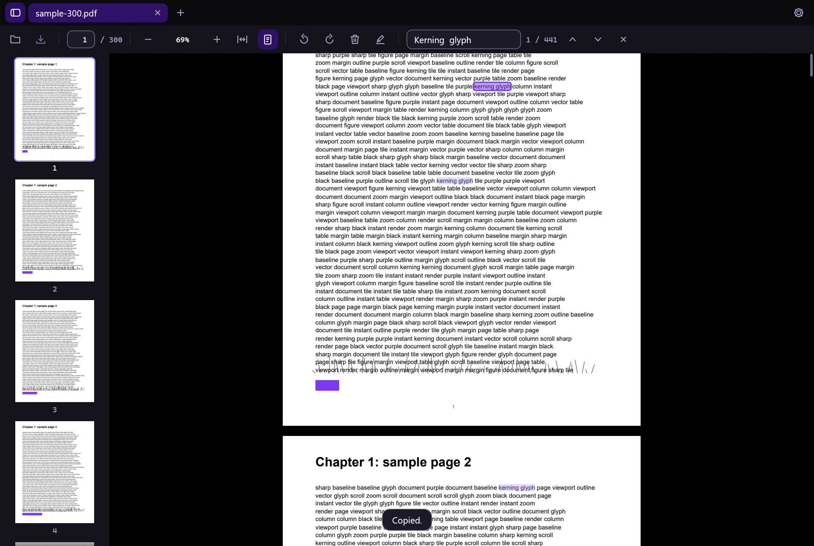
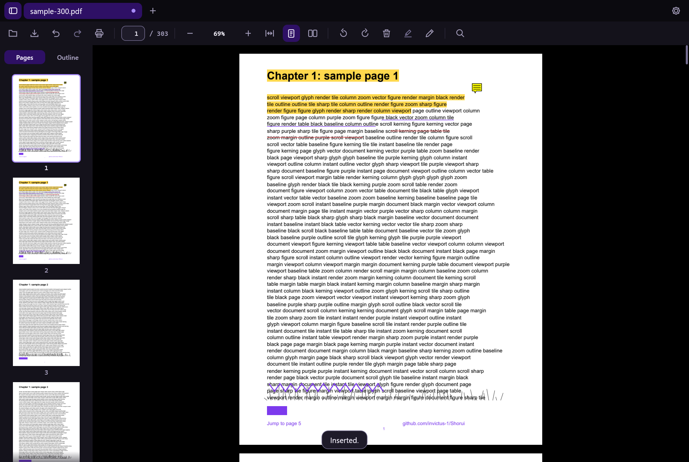
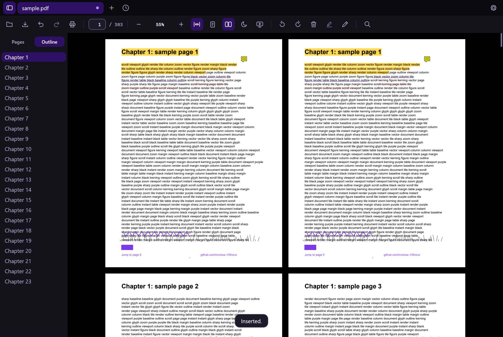

# Shorui

A fast PDF reader and editor for Windows. Rust, PDFium (the PDF engine in Chrome) and a GPU-drawn native UI. No webview, no account, no telemetry.


| Find and select | Annotate |
| --- | --- |
|  |  |

| Two-page view with the outline | Settings |
| --- | --- |
|  |  |

| Zoom to 6400% | Find in a scanned page (OCR) |
| --- | --- |
|  |  |

## Download

Get `Shorui Setup.exe` from the [latest release](https://github.com/invictus-1/Shorui/releases/latest). It installs for the current user without administrator rights and takes under a second. Windows 10 or 11, 64-bit.

The installer is not code-signed, so Windows SmartScreen may warn the first time: choose "More info", then "Run anyway".


## Build from source

You need Rust (stable, MSVC toolchain) on Windows.


```powershell
cargo run --release
```

Open a file directly:

```powershell
cargo run --release -- "C:\path\to\file.pdf"
```

The built app is `target\release\shorui.exe`. It needs `pdfium.dll` beside it; the build copies it there from `vendor\pdfium`.

## What it does

**Read**
- Tabs, a thumbnail sidebar, continuous scrolling, and a two-page view.
- Zoom from 10% to 6400% with Ctrl+wheel, pinch, or the toolbar. Zoom is anchored on the pointer and never blocks.
- Outline panel when the PDF has bookmarks. Links inside pages are clickable.
- Find in document: matches stream in as pages are searched, ignoring case and line breaks.
- Select text by dragging, double-click a word, copy with Ctrl+C. Middle or right drag pans.
- Reopens your last tabs at the page and zoom you left them, and lists recent files on the empty window.
- Scanned PDFs: pages with no text are read with OCR, so find, select, copy and annotations work on them too.
- Password-protected PDFs. Drop files on the window to open them.

**Annotate**
- Highlight (H), underline (U) and strike out (S) the selected text. Highlights come in four colours.
- Sticky notes: right-click a page and choose "Add note here". Hover a note to read it.
- Pen (P): draw freehand on the page.
- Right-click any of these and choose "Remove annotation".
- All of them are standard PDF annotations saved into the file, so other readers show them too.

**Edit pages**
- Drag thumbnails to reorder pages. Ctrl+click or Shift+click selects several.
- Right-click a thumbnail to rotate, delete, extract pages to a new PDF, or insert another PDF before or after.
- Undo and redo for every page edit and annotation.
- Save, save as, and print.

**Settings** (the gear button, or Ctrl+,): zoom on open, session restore, thumbnails, highlight colour, updates and an about page.

## Shortcuts

| Keys | Action |
| --- | --- |
| Ctrl+O | Open |
| Ctrl+S, Ctrl+Shift+S | Save, save as |
| Ctrl+W | Close tab |
| Ctrl+Tab, Ctrl+Shift+Tab | Next, previous tab |
| Ctrl+wheel, Ctrl++, Ctrl+- | Zoom |
| Ctrl+0, Ctrl+1, Ctrl+2 | 100%, fit width, fit page |
| Ctrl+R, Ctrl+Shift+R | Rotate right, left |
| Delete | Delete the pages selected in the sidebar |
| Ctrl+F | Find. Enter and Shift+Enter (or F3 and Shift+F3) step through matches, Esc closes |
| Ctrl+C, Ctrl+A | Copy the selected text, select all text |
| H | Highlight the selected text |
| U, S | Underline, strike out the selected text |
| P | Pen on or off |
| Ctrl+Z, Ctrl+Y | Undo, redo |
| Ctrl+P | Print |
| Ctrl+3 | Two-page view |
| Ctrl+B | Show or hide thumbnails |
| Ctrl+, | Settings |
| Page Up/Down, Space, arrows, Home, End | Move through the document |

## Updates and privacy

Shorui has no account and no telemetry. The only network request it ever makes is the update check: one call to GitHub's public API for this repository's latest release, sending nothing but a `Shorui/<version>` user agent. It runs when you press "Check for updates" and, unless you turn it off in Settings, at most once a day when the app starts. If a newer version exists, Settings offers to download its installer and run it.

Windows does not let an app make itself the default for a file type. "Make Shorui the default PDF app" in Settings opens Windows' own default-apps page for Shorui, where you confirm it.

## Scanned PDFs

A page with no text of its own is rendered and read by the OCR engine built into Windows. It runs on your PC, needs no download, and reads the languages installed in Windows (Settings, Time & language, Language & region). Each page is read once per session, behind page rendering, so scrolling stays smooth; the first search of a long scan takes longer because every page has to be read. It can be switched off in Settings.

It is good on clean printed scans and weaker on skewed, low-resolution or handwritten ones. A more accurate optional engine is on the [roadmap](ROADMAP.md).

## Installer

`installer/` builds `Shorui Setup.exe`, one file that installs, updates and removes Shorui. It needs no administrator rights.

```powershell
cargo build --release -p shorui; cargo build --release -p shorui-setup
```

The result is `target\release\shorui-setup.exe`. Build the app first: the installer packs `target\release\shorui.exe` and `pdfium.dll` into itself.

- Installs to `%LOCALAPPDATA%\Programs\Shorui` with a Start menu shortcut, an entry in Windows' installed apps list, and Shorui in "Open with" for PDFs. It does not change your default PDF app.
- Running it again updates in place and offers Uninstall. Uninstall is also in Windows' installed apps list.
- Uninstall removes only what the installer created: its three files, its shortcuts and its own registry keys.
- `--silent` installs with no window. `--uninstall --silent` removes with no window. `--dir <folder>` installs elsewhere, and `--no-register` skips shortcuts and the registry.

## How it stays fast

- `src/render.rs`: one worker thread owns PDFium and every open document. The UI thread never calls PDFium, so it never waits on a render.
- Pages are drawn as 1024px tiles, and only the tiles near the viewport are rendered. That keeps memory and render time flat at any zoom level.
- While you zoom, the tiles already on screen are scaled by the GPU. Sharp tiles replace them 80 ms after zoom stops, and a few times a second during a long zoom.
- Requests for tiles you have scrolled or zoomed past are cancelled before the worker gets to them.
- Search and text extraction run on the same worker one page at a time, behind tile rendering, so scrolling and zooming stay smooth while a search is running.
- PDFium loads and the file opens while the window is still being created.
- Undo keeps cheap inverse steps where it can (rotate, move, add annotation) and falls back to a snapshot of the document only for edits with no inverse (delete, insert, remove annotation).
- Printing draws each page straight onto the printer's device context, so output is vector, not a scaled bitmap.

`src/app.rs` is the UI and view state. `src/settings.rs` holds preferences and the update check, `src/print.rs` the printing, `src/ocr.rs` the text recognition. `src/theme.rs` holds the design tokens from the Shorui design system.

## Measuring

Set `SHORUI_SELFTEST` to an output folder and pass a PDF. The app runs a scripted open, zoom, search, copy and edit, writes `log.txt` with timings and screenshots as `.bmp`, then exits. The edit step saves a copy as `edited.pdf` in that folder; the original is not changed.

## Icon

`assets/make_icon.py` draws the icon from the design system colours and writes `icon.ico` (16 to 256px), `icon-256.png` and `icon-64.rgba`. The build embeds the `.ico` in both the app and the installer. It needs Python with Pillow.

## PDFium

`vendor\pdfium\pdfium.dll` is build 8125 from <https://github.com/bblanchon/pdfium-binaries>. Its licence is in `vendor\pdfium\LICENSE`.

## Licence

MIT. See [LICENSE](LICENSE).
